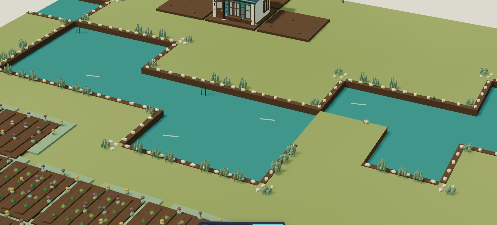

# Living Layers — correction des berges, 5 novembre 2026

Le décor superposait des cases de 0,95 unité au terrain réel de 1 unité, avec
sa propre eau au-dessus de la rivière. Les roseaux portaient un carré de terre
qui débordait après leur placement. Le terrain et la simulation étaient corrects.

La correction remplace ces modules par une bordure étroite à la vraie limite
terre/eau. Les raccords droits couvrent une unité entière ; les angles en L
ne superposent pas leurs faces. Un contact diagonal reçoit seulement quelques
pierres et plantes. Les roseaux sont enracinés sur la terre, sans socle.
Les quais fonctionnels gardent leur propre plateforme, orientation et ciblage.

Les règles, coûts, sauvegardes, terrain et modèles des bâtiments restent inchangés.
Cinq GLB sont régénérés avec Blender 4.5.3 LTS. L'export autonome intègre les
102 modèles actuels et correspond au code source.

## Validation locale

- `npm test` : 166 tests réussis, dont huit nouveaux tests sur les vrais GLB
  et un contrôle de non-superposition sur les quais fonctionnels.
- Les huit tests GLB reproduisaient les défauts avant correction : sept échecs,
  seul le terrain original passait. Ils vérifient les matrices réelles du renderer,
  les quatre orientations, raccords droits/angles et chaque racine de roseau.
- `npm run build` et `npm run test:artifact` : réussis ; 102 GLB incorporés.
- Relecture indépendante et 33 tests ciblés environnement/quais/barges : réussis.
- Recette manuelle dans Edge : zoom à la molette, rotations de caméra dont angle
  rasant, modes perspective et orthographique, construction d'une maison en rive.
  Les anciennes plaques ne sont plus visibles ; bordures et roseaux restent ancrés.
- Rendu dans le navigateur intégré à 3840 × 2160, canvas de même définition,
  puis retour à la taille initiale. Pas d'erreur ni d'avertissement console observé.
  Cette recette porte sur le PC utilisé, pas sur tous les appareils.

Analyse avec Kimi K3 ; correction et intégration par Nilo, relecture indépendante.
La publication LOB7 est une étape distincte, consignée dans la PR après sa réussite.
